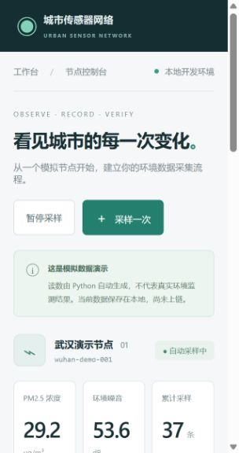

# 城市传感器网络 · BOT Chain Demo

在线体验：<https://city-sensor-network-demo.vercel.app/>

城市传感器网络是一个环保数据可信交付 Demo：模拟 PM2.5 和噪音采样，把读数打包成 JSON，在 BOT Chain 主网记录文件指纹，并用链上订阅控制网站的完整文件下载和数据解析。仓库根目录保留早期本地原型；当前线上程序位于 [`vercel-demo/`](vercel-demo/README.md)。

> **演示边界：** 读数由程序模拟，尚未接入真实传感器。链上存证证明文件与登记时一致，不能单独证明现实读数准确。



## BOT Chain 在项目中的作用

- **订阅授权：** 使用者通过合约 `subscribe` 支付 BOT；后端按签名登录的钱包地址调用 `isValidSub`，判断数据流 `0` 的订阅是否有效。
- **批次存证：** 数据方计算原始 JSON 字节的 SHA-256，调用 `recordData` 登记数据流编号、文件指纹和文件名。链上不保存 JSON 原文。
- **独立核验：** 验证页重算所选文件的指纹，检查 BOT Chain 交易回执中的 `DataRecorded` 事件是否与数据流、指纹和文件名一致。

网络：BOT Chain Mainnet，Chain ID `677`，RPC <https://rpc.botchain.ai>，原生代币 `BOT`。合约地址：[`0xC55793411e9fC98288bA09976D607cEAf94650bB`](https://scan.botchain.ai/address/0xC55793411e9fC98288bA09976D607cEAf94650bB)；[部署交易](https://scan.botchain.ai/tx/0x6bf8fb17bd0d08dcd425f445bc5d23a520e6555b77f00bd4c0d9c9c89007051e)。钱包登录签名不扣 BOT；购买订阅和上链存证是需钱包确认、支付 BOT 的交易。

## 线上操作指南

1. 打开[产品介绍](https://city-sensor-network-demo.vercel.app/)，进入[节点控制台](https://city-sensor-network-demo.vercel.app/console)。页面可见时约每秒请求一次模拟采样；游客可查看少量读数和趋势，无需钱包。
2. 数据提供方用合约 owner 钱包连接 MetaMask 并签名登录。积累读数后手动打包，在批次列表下载原始 JSON 留作备份。
3. 数据方在该批次点击“上链”，于 MetaMask 确认交易。页面显示区块号和交易链接，并核对链上存证事件。仅上链指纹，不上传 JSON 内容。
4. 数据使用方进入[数据订阅](https://city-sensor-network-demo.vercel.app/subscribe)，连接付款钱包、选择天数、核对合约实时价格和总额，再确认订阅交易。已有有效订阅的账户无需重复购买。
5. 有效订阅者回到控制台下载当前可用的完整云端 JSON；进入[订阅者解析](https://city-sensor-network-demo.vercel.app/parser)，刷新订阅状态，选择 JSON 并点击“解析数据”。可看统计、趋势、逐条记录和导出 CSV。解析接口每次都会再次核对链上订阅；即使是合约 owner，也须有有效订阅才能使用解析服务。
6. 进入[文件验证](https://city-sensor-network-demo.vercel.app/verify)，上传未经修改的原始 JSON，比较实算 SHA-256 与主网回执。还可以下载“未存证 JSON”对照样例，观察核验失败的效果。

解析页若显示未订阅，先核对页面中的登录钱包是否就是付款钱包，再点击“切换 / 重新验证钱包”或“刷新订阅状态”。建议在安装 MetaMask 的 Chrome 或 Edge 中体验钱包流程。

## 页面与角色

| 页面 | 游客 | 数据方 / 订阅者 |
| --- | --- | --- |
| `/` 产品介绍 | 了解社会、技术与商业价值 | 选择体验路径 |
| `/console` 节点控制台 | 查看公开预览 | 数据方打包、存证；有效订阅者下载批次 |
| `/subscribe` 数据订阅 | 查看说明 | 钱包签名、查看价格、购买与核对订阅 |
| `/parser` 订阅者解析 | 查看权限提示 | 有效订阅者上传 JSON、查看图表与导出 CSV |
| `/verify` 文件验证 | 验证手中的文件 | 核对指纹、交易回执和未存证样例 |

## 数据保存与交付

- 配置 `DATABASE_URL` 为 PostgreSQL 连接串后，线上服务端读数、批次元数据和原始 JSON 字节保存在数据库；未配置时回退到实例临时存储，重启后可能丢失。不要把连接串提交到 GitHub。
- 云端仍保存原文的服务端批次，可由有权限的钱包在其他设备重新登录后下载。本机生成的 `browser-batch` 原始 JSON 只保存在当前浏览器；数据方须下载备份并另行交付。仅凭 SHA-256 指纹无法恢复文件。
- 订阅控制网站的受控下载与解析接口。文件一旦下载，不能撤回，也无法禁止使用者用其他软件读取。解析页支持最多 2 MB、5,000 条采样记录；解析文件原文不作持久保存。

## 本地运行

根目录的 `app.py` 是早期本地原型，默认配置为 BOT Chain Testnet（Chain ID `968`）；当前线上主网功能请运行 `vercel-demo/`，两套网络的部署状态不要混淆。GitHub 网页只展示源码，不会直接运行 FastAPI。需要 Python 3.11 或更高版本。

Windows PowerShell：

```powershell
git clone https://github.com/WsyZpc/city-sensor-network-demo.git
cd city-sensor-network-demo\vercel-demo
python -m venv .venv
.\.venv\Scripts\python.exe -m pip install -r requirements.txt
.\.venv\Scripts\python.exe app.py
```

macOS / Linux：

```bash
git clone https://github.com/WsyZpc/city-sensor-network-demo.git
cd city-sensor-network-demo/vercel-demo
python3 -m venv .venv
.venv/bin/python -m pip install -r requirements.txt
.venv/bin/python app.py
```

浏览器打开 <http://127.0.0.1:8000>。本地未配置 `DATABASE_URL` 时使用 SQLite；部署 Vercel 时将 Root Directory 设为 `vercel-demo`，并通过项目环境变量配置数据库连接串。详见 [Vercel 版说明](vercel-demo/README.md)。

## 项目结构与检查

| 路径 | 用途 |
| --- | --- |
| `vercel-demo/app.py` | 当前线上 FastAPI 服务、钱包会话、权限与接口 |
| `vercel-demo/storage.py`、`batches.py` | 读数、批次与原始文件存储 |
| `vercel-demo/chain.py` | BOT Chain JSON-RPC 查询和存证交易核验 |
| `vercel-demo/templates/` | 产品介绍、控制台、订阅、解析、验证页面 |
| `vercel-demo/templates/static/` | 前端脚本、样式、ABI 与主网配置 |
| 根目录 `app.py`、`templates/` | 早期本地测试网原型 |

在 `vercel-demo/` 中运行相关检查：

```powershell
.\.venv\Scripts\python.exe -m unittest discover -s tests -v
node tests/frontend_smoke.cjs
node tests/test_verify_demo.cjs
```

## 现阶段限制

- 所有采样仍是模拟数据，真实设备身份、校准与质押防作弊尚未实现。
- `contracts/DataAttestation.sol` 是早期草稿，不是已部署的 `SensorDataMarket` 合约源码；当前运行以主网合约 ABI 为准。
- 云端批次能否跨设备下载取决于原文件是否仍在服务端保存；浏览器本机批次不会自动同步。
- 购买订阅不等于文件自动交付，也不能撤回已下载文件。当前尚无生产级数据 API、设备运营或服务等级承诺。
